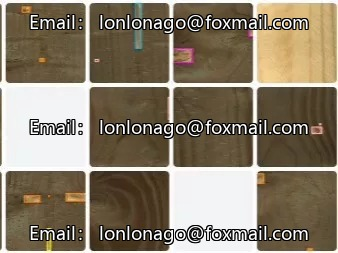
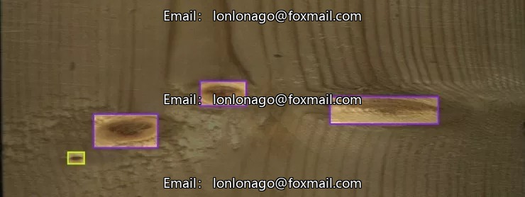
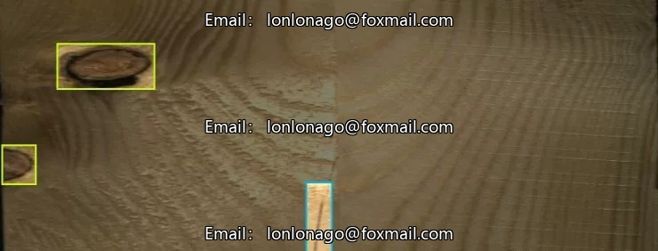
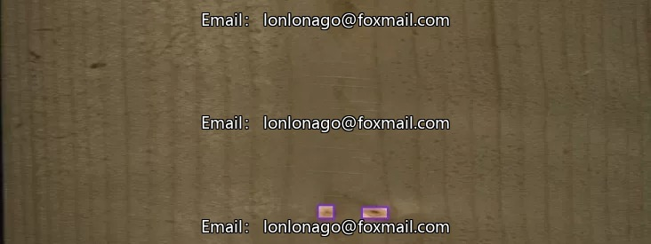
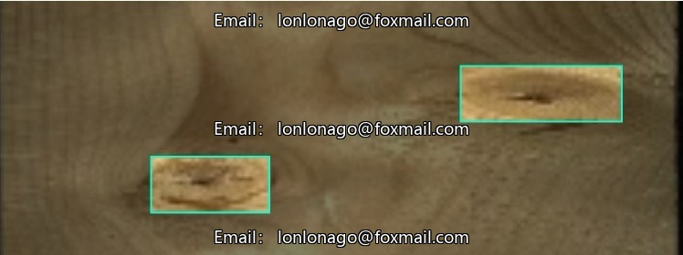
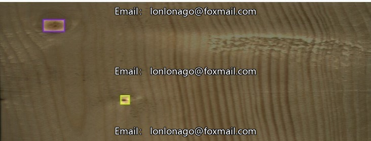
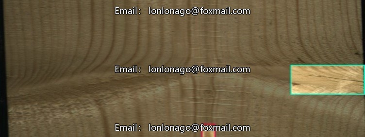

# Wood Defect and Crack Identification Dataset Based on Convolutional Neural Networks, Issue 10095

## Body

Wood Defect and Cracks Detection Dataset based on Convolutional Neural Network, Issue 10095, Computer Vision Dataset for Object Detection, containing 10 subcategories: Blue Varnish, Crack, Death Scab, Hollow, Living Spur, Bone, Quartzite, Cracked Scab, Weeds, Resin, totaling 4159 images. The dataset is suitable for training and validation of basic models, covering common defects such as wood knots, cracks, blue varnish, etc., supporting object detection tasks.

The dataset includes image files (JPG, PNG, etc.) and corresponding annotation files (XML, TXT, etc.), with annotation information covering the bounding box of the target and category labels, facilitating direct use for model training input. Category settings highly align with the pain points of the timber industry, suitable for scenarios such as timber quality inspection, automation in processing, and optimization of computer vision models.

Virtual materials, once sold, are non-refundable.
Interested friends, click "I want" to proceed.

## Images

## Payment

Here is a pay link on Stripe ( https://buy.stripe.com/3cs8yP7sY87d0vu9AB ). Please contact me lonlonago@foxmail.com after funding $89, and I will send you a complete data files , thank you!

